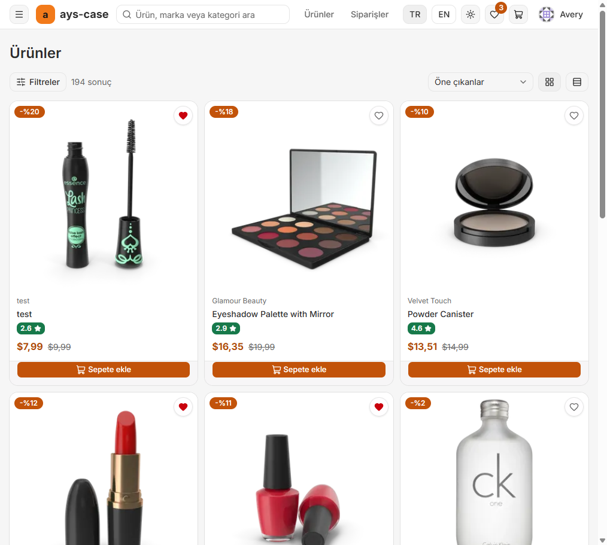
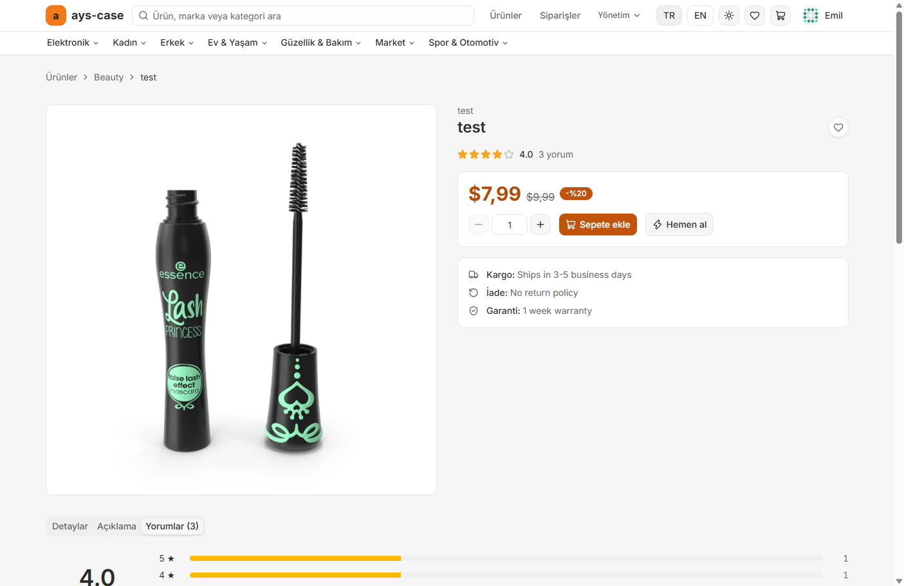
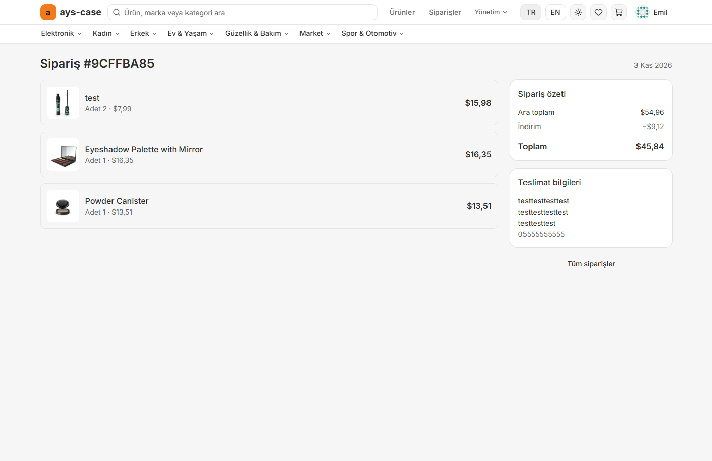
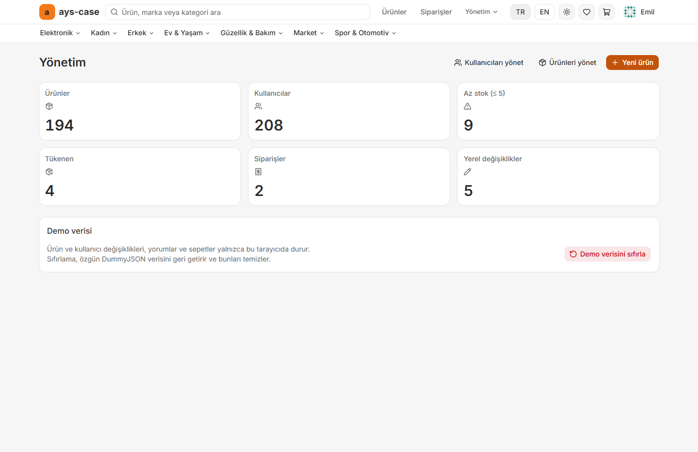
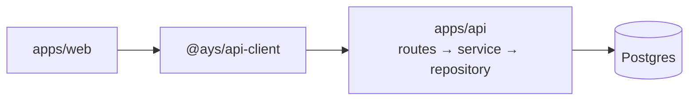

# Ays Case

A Trendyol-style online shop: catalog and search, accounts with roles, per-user cart and favorites, checkout with orders, reviews, and an admin panel. It is a full-stack app: a React SPA, a Hono API on Postgres, and shared packages.

**Live:** https://ayscase.vercel.app · **API docs:** https://ayscase.vercel.app/api/docs

| Shop | Product |
|:---:|:---:|
|  |  |
| **Order** | **Admin** |
|  |  |

## Layout

```text
apps/web          Vite + React SPA
apps/api          Hono API, Drizzle, Better Auth (Postgres on Supabase)
packages/*        shared code: @ays/validators (Zod schemas), @ays/api-client (typed Hono RPC client)
docs/             architecture, API, backend, errors, decisions
```



## Run it

```bash
pnpm install
pnpm dev          # web on http://localhost:5173, API on http://localhost:3000 (Vite proxies /api)
pnpm lint
pnpm typecheck
pnpm test         # unit + integration (the API tests use an in-memory Postgres)
pnpm e2e          # Playwright
```

Node 24+ and pnpm 11+. All commands run from the root of the pnpm + Turborepo workspace. The API needs `apps/api/.env.development`: copy `apps/api/.env.development.example` and fill in the values.

### Environment variables (names only)

| Variable               | Used for                                                                          |
| ---------------------- | --------------------------------------------------------------------------------- |
| `DATABASE_URL`         | Postgres, transaction pooler (port 6543), used by the running API                 |
| `DATABASE_URL_SESSION` | Postgres, session pooler (port 5432), used by migrations                          |
| `BETTER_AUTH_SECRET`   | at least 32 random characters; required on any hosted deployment                  |
| `BETTER_AUTH_URL`      | optional; overrides the base URL Better Auth derives from Vercel's variables      |
| `LOG_LEVEL`            | `debug`, `info`, ...                                                              |

Database migrations: `pnpm --filter @ays/api db:migrate:dev` (or `db:migrate:prod`). There is no seed script; see [docs/backend.md](docs/backend.md) for the data, the tests' fixture and how to restore the old seed.

## Deployment

One Vercel project using [Services](https://vercel.com/docs/services) (Beta), configured in the root `vercel.json`: the web app at `/` and the API at `/api`, on the same domain, so cookies are first-party and there is no CORS. Every preview deployment of the web app talks to the matching preview API. Set the environment variables above for Production and Preview in the Vercel dashboard. The free Supabase project pauses after about a week of inactivity; how to restore it is in [docs/backend.md](docs/backend.md#operations).

## Demo accounts

| Role  | Username | Password     |
| ----- | -------- | ------------ |
| Admin | `emilys` | `emilyspass` |
| User  | `averyp` | `averyppass` |

They are public on purpose, and the login page has one-click fill buttons. Nobody can sign up; admins create users.

## Features

- Sign in and out, session restore, protected and admin-only routes (enforced by the API)
- Search, category mega-menu, filters, sorting, numbered pagination (URL-synced)
- Product page with gallery, reviews (create, edit, delete), favorites
- Server-side cart, favorites and recently viewed; checkout creates an order in one transaction
- Admin: dashboard, product, lookup and user management
- TR / EN, light / dark, responsive, accessible (axe checked)

## Stack

React 19 · Vite · TypeScript · Tailwind 4 · shadcn/ui · TanStack Router, Query, Form, Table · Zustand · Zod · i18next · Hono · Drizzle · Better Auth · Postgres · Vitest · Playwright · GitHub Actions · Vercel

Product images are served from `cdn.dummyjson.com`; the catalog data was originally imported from [DummyJSON](https://dummyjson.com).

## How it was built (AI workflow)

1. **Plan:** a consultant agent turned the case brief into requirements, architecture, API notes, ADRs and a gated plan.
2. **Issues:** every gate and every follow-up became a GitHub issue.
3. **Build:** a developer agent implemented one issue per branch and opened a PR, following the rules in [`AGENTS.md`](AGENTS.md).
4. **Review:** CI (lint, format, typecheck, tests, build, e2e) ran on every PR; I reviewed and tested, then merged. The agent never merged on its own.
5. **Project manager pass:** a separate agent reviewed the finished repo and filed new issues, which went through the same issue → PR → review loop.

More detail on architecture and decisions is in [`docs/`](docs/); the backend is described in [docs/backend.md](docs/backend.md).
