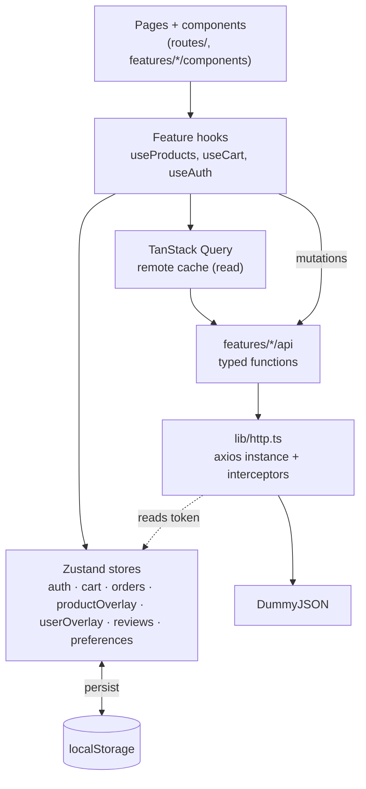
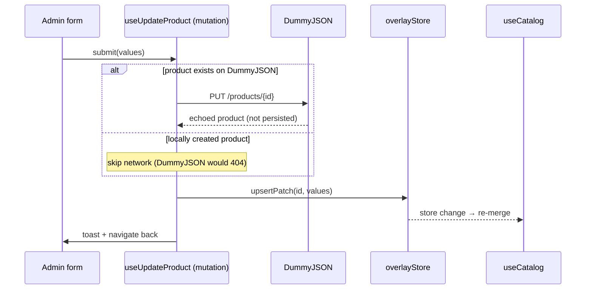

# Architecture

A pnpm + Turborepo workspace. Today only `apps/web` (the Vite SPA) exists; `apps/api` and shared `packages/*` come with the backend work. Practices that carry over from StokMate are listed in [conventions.md](conventions.md).

## Layers



Rules:

- Components never call axios or `api/` directly; they use feature hooks.
- Remote data → TanStack Query. Local-only / user-owned data → Zustand. See [data-and-state.md](data-and-state.md) for the exact split.
- The only place remote + local are merged is `features/products/hooks/use-catalog.ts` (the overlay merge).

## Folder structure

```text
ays-case/
├── .github/workflows/ci.yml
├── docs/                         # this doc set
├── AGENTS.md  README.md  dummyjson.json
├── package.json  pnpm-workspace.yaml  turbo.json  pnpm-lock.yaml
└── apps/web/
    ├── e2e/                          # Playwright specs
    ├── public/
    ├── src/
    │   ├── main.tsx                  # providers + router
    │   ├── router.tsx                # createRouter, context { queryClient, auth }
    │   ├── routeTree.gen.ts          # generated, committed
    │   ├── routes/                   # TanStack file routes (thin: load + render a page)
    │   │   ├── __root.tsx
    │   │   ├── index.tsx             # → redirect /products
    │   │   ├── login.tsx
    │   │   ├── forbidden.tsx
    │   │   ├── products/index.tsx
    │   │   ├── products/$productId.tsx
    │   │   ├── _auth.tsx             # guard: logged in
    │   │   ├── _auth/cart.tsx
    │   │   ├── _auth/checkout.tsx
    │   │   ├── _auth/orders/index.tsx
    │   │   ├── _auth/orders/$orderId.tsx
    │   │   ├── _auth/_admin.tsx      # guard: role === "admin"
    │   │   ├── _auth/_admin/admin/index.tsx
    │   │   ├── _auth/_admin/admin/products/index.tsx
    │   │   ├── _auth/_admin/admin/products/new.tsx
    │   │   ├── _auth/_admin/admin/products/$productId.edit.tsx
    │   │   ├── _auth/_admin/admin/users/index.tsx
    │   │   ├── _auth/_admin/admin/users/new.tsx
    │   │   └── _auth/_admin/admin/users/$userId.edit.tsx
    │   ├── features/
    │   │   ├── auth/      { api.ts, store.ts, schemas.ts, components/, hooks/ }
    │   │   ├── products/  { api.ts, overlay-store.ts, schemas.ts, query-keys.ts, catalog.ts, components/, hooks/ }
    │   │   ├── cart/      { store.ts, selectors.ts, components/ }
    │   │   ├── orders/    { api.ts, store.ts, components/ }
    │   │   ├── users/     { api.ts, overlay-store.ts, schemas.ts, catalog.ts, query-keys.ts, components/, hooks/ }
    │   │   ├── reviews/   { store.ts, schemas.ts, summary.ts, components/ }
    │   │   └── admin/     { components/ }  # shared admin table, product form, stats
    │   ├── components/
    │   │   ├── ui/                   # shadcn generated
    │   │   ├── layout/               # AppShell, Header, MobileNav, UserMenu
    │   │   └── feedback/             # ErrorState, EmptyState, PageSkeleton, NotFound, Forbidden
    │   ├── lib/
    │   │   ├── http.ts               # axios instance, auth + refresh interceptors
    │   │   ├── http-error.ts         # AxiosError → AppError
    │   │   ├── query-client.ts
    │   │   ├── storage.ts            # versioned localStorage keys, safe JSON
    │   │   ├── format.ts             # currency, dates (Intl)
    │   │   └── utils.ts              # cn()
    │   ├── i18n/ { index.ts, locales/en.ts, locales/tr.ts }
    │   ├── preferences/              # theme + language store and controls
    │   ├── test/ { setup.ts, msw/handlers.ts, msw/server.ts, fixtures/, render.tsx }
    │   └── styles.css                # Tailwind + theme tokens
    ├── scripts/check-translation-parity.mjs
    ├── components.json  eslint.config.js  prettier.config.mjs
    ├── tsconfig.json  vite.config.ts  vitest.config.ts  playwright.config.ts
    (apps/web has no vercel.json: the SPA rewrite lives in the web service of the root vercel.json)
```

Feature rule: a feature may import from `lib/`, `components/`, and another feature's **public** hooks/types only (e.g. `cart` imports `products` types). No deep imports into another feature's internals.

## Auth flow

```mermaid
sequenceDiagram
    participant U as User
    participant L as Login page
    participant S as authStore
    participant H as http (axios)
    participant D as DummyJSON
    U->>L: username + password
    L->>H: POST /auth/login
    H->>D: request
    D-->>H: { accessToken, refreshToken, id, … }
    L->>S: setTokens()
    L->>H: GET /auth/me
    D-->>H: full user (incl. role)
    L->>S: setUser(); status = "authenticated"
    L->>U: navigate(redirect ?? "/products")

    Note over S,D: On refresh: persisted tokens → bootstrap() → GET /auth/me<br/>401 → POST /auth/refresh once → retry → else logout()
```

`authStore.bootstrap()` is idempotent (one promise, like StokMate's `ensureRestored`). Route guards `await` it in `beforeLoad`, so there's no flash of protected content.

## Product write flow (admin)



## Key libraries and why

| Need         | Library                         | Why                                                                                                                                   |
| ------------ | ------------------------------- | ------------------------------------------------------------------------------------------------------------------------------------- |
| Routing      | TanStack Router                 | Typed routes + typed search params (`?q&category&sort&page`), `beforeLoad` guards, loaders that prefetch Query data. Same as StokMate |
| Server cache | TanStack Query                  | Loading/error/retry/cache for DummyJSON reads, `useMutation` for writes. Same as StokMate                                             |
| Local state  | Zustand + `persist`             | Required by brief; small, no provider, works outside React (axios interceptor reads tokens)                                           |
| HTTP         | Axios                           | Required by brief; interceptors for token + refresh                                                                                   |
| Forms        | TanStack Form + Zod             | Same as StokMate; Zod schemas shared between form validation and API response parsing                                                 |
| UI           | shadcn/ui + Tailwind 4 + lucide | Same as StokMate; accessible Radix primitives                                                                                         |
| Tables       | TanStack Table                  | Admin table sorting/pagination; same as StokMate                                                                                      |
| Toasts       | sonner (shadcn)                 |                                                                                                                                       |
| i18n         | i18next + react-i18next         | Same as StokMate                                                                                                                      |
| Tests        | Vitest, RTL, MSW, Playwright    | MSW mocks DummyJSON so tests don't hit the network                                                                                    |

See ADRs in [decisions/](decisions/) for the contested choices.
